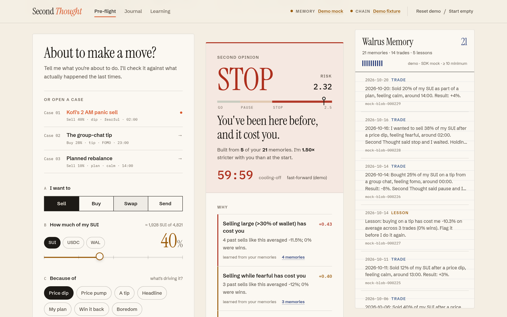

# Second Thought

**The wallet co-pilot that remembers what you'd rather forget, and stops you before you repeat it.**

Built for **Walrus × Tatum: Total Recall**. Track: **Consumer Finance Apps**. Also aimed at the **Best Walrus Memory** special prize ("memories that visibly change the product").



Before you sell, buy, swap or send, you tell Second Thought what you're about to do and why. It reads your wallet on Sui through **Tatum**, recalls similar moments from **Walrus Memory**, and gives you a GO / PAUSE / STOP with the receipts: *"4 past sells like this averaged -11.5%; 0% were wins."* You stay in control, and it never moves funds. Afterwards you log how it went, the result is written back to Walrus Memory, and the next verdict changes. If you overrode a warning and lost, it gets stricter with you.

> **Status honesty.** In this repo's default **DEMO mode** the memories live in the Walrus Memory SDK's official offline mock and the wallet is a fixed fictional fixture. Nothing is on mainnet until you complete `NEXT_STEPS.md` (create a Memory account, get a Tatum key, run the store script). The UI badges and `/api/status` always say which mode is active, and live mode refuses to start without real keys. Read [Honest limits](#honest-limits).

---

## 1. Hackathon requirements (recorded from the official rules)

Source: https://thewalrussessions.wal.app/tatum-total-recall/index.html (event page: https://tatum.io/hackathon/total-recall). Checked 2026-10-23.

**Dates.** Opens Oct 20 2026. **Submission deadline Nov 10 2026, 17:00 UTC = 17:00 in Accra.** Results Nov 17 2026. A winner must confirm by email and give a USDC-capable wallet **within 14 days of the official announcement**, plus a small test transaction.

**Eligibility.** 18+ (or age of majority). Not a resident of a sanctioned or restricted jurisdiction. Sponsor employees/contractors may be ineligible. **One submission per person.** Work must be original (or authorised), "completed or materially advanced during the Hackathon Duration". The IP stays yours, but the Sponsors get a licence to showcase it.

**Submission form** (https://recall-tatum-walrus.vercel.app): Email · Discord handle · LinkedIn · How did you hear about this event? · Is this your first Web3 project? · Tatum ID · SUI address · Account ID (SUI) · MEMWAL_AGENT_ID · Project description · Short demo video (2 to 3 min) · GitHub repo · How was your experience building with Walrus? · How was your experience building with the Tatum AI Builder?

**Submission requirements**
1. Walrus Memory integrated and **writing on Mainnet**.
2. **Tatum RPC** used for onchain data where relevant.
3. **At least 10 memories stored on Mainnet.**
4. **Published blog post**: what it does, how it uses Tatum + Walrus, how it learned over time.
5. Working demo and public repo.
6. Optional: build with Tatum AI Builder (ai.tatum.io) for the $500 bonus.

**Tracks** (each $1,000: 1st $500, 2nd $300, 3rd $200): *Markets & Sports Prediction* · *Smart Agents for Real Life* · *Consumer Finance Apps*.

**Special prizes** ($500 each): *Best Walrus Memory* ("deepest learning loop, memories that visibly change the product") · *Best Tatum AI Builder App* · *Mystery Bounty* (revealed on Discord). **Pool: $4,500 USDC.**

**Judging**: Walrus + Tatum integration **30%** · Technical quality **30%** (clean code, successful Tatum Sui RPC integration) · Creativity **20%** · Presentation **20%** (docs and working demo). Bonus for sharing on X or LinkedIn (tagging @Tatum_io and @WalrusFoundation is optional and may earn extra points).

**Eligibility notes and flags**
- *Pre-built code:* the rules don't ban libraries or boilerplate, but ask for work "completed or materially advanced during the Hackathon Duration". Everything here was written after Oct 20 2026 (see git history). Open-source dependencies are used normally. If you want certainty, ask in the Discord.
- *Rules boilerplate mismatch:* the rules page says the overarching goal is "a Network-native feedback and form platform", which doesn't match the three tracks or the submission requirements. It looks like leftover text. The tracks and requirements are what the submission form and judging refer to. Worth a one-line question on Discord.
- *Tatum AI Builder bonus:* not pursued. This project wasn't built primarily with ai.tatum.io, and the form asks about that experience. Answer the field honestly.

## 2. Why this track

*Consumer Finance Apps* says: "Money products people actually open… Blockchain stays invisible. Walrus Memory makes balances, habits, and preferences stick across sessions." Second Thought is a habits product: it stores spending/trading **habits** (trigger, mood, size, time of day) and **preferences**, and the stored memory *changes the answer*. That is also exactly the Best Walrus Memory criterion, so one build is a candidate for a track prize and the special prize. (A user can win at most the prizes the Sponsors decide; one submission per person.)

## 3. How it works

```
 you ──► Composer (action · asset · % · trigger · mood · time)
                │
        POST /api/preflight
                │
   ┌────────────┴────────────┐
   ▼                         ▼
 Tatum Sui RPC            Walrus Memory
 balances, 24h tx count   recall("sell 40% of SUI after a dip, fearful, 02:00")
 gas, checkpoint          + list of all journal memories
   └────────────┬────────────┘
                ▼
        shared/engine.ts  evaluate()
   patterns by trigger / mood / size / hour  (only trades you actually made)
   × strictness (learned from overrides)  + default guard-rails + chain context
                ▼
      GO / PAUSE / STOP + reasons that cite the exact memories
                ▼
   you choose ─► later you log the result ─► memwal.rememberAndWait()
                ▼
   lessons are written back when a pattern has n≥3 and a clear average
```

**What gets stored in Walrus Memory.** One readable sentence per fact, followed by compact tags, e.g.

```
[2nd] 2026-10-06: Sold 40% of my SUI after a price dip, feeling fearful, around 02:00. Result: -12%. Second Thought said stop and I went ahead anyway. #kind=trade #date=2026-10-06 #action=sell …
```

The sentence makes **semantic recall** work and lets a human audit the memory. The tags let the app rebuild its model from recalled text with **no database**: memory is the only store. Three kinds: `trade` (a decision and its result), `lesson` (a reflection the app writes after a pattern emerges), `pref` (standing preferences).

**How memories visibly change the product** (what a judge can verify in the UI):
1. *Cold start:* "Start empty" → the same move gets GO with "No history yet. Go ahead, and I'll start learning."
2. *Memory in, verdict out:* with the 21-memory sample journal, Kofi's 2 AM panic sell is **STOP, risk 2.32**, citing several patterns and the exact memories behind each (hover a "memories" chip: the matching items light up in the right rail).
3. *Learning from your overrides:* proceed anyway, log -8%, and the **same move jumps to risk 3.48** with strictness 1.50× → 1.75×. New lessons are written into memory.
4. *Replay:* the Learning tab replays one move against 0…N memories: GO → PAUSE → STOP, step by step.
5. *Safer size:* a smaller size that has worked before is suggested ("moves of 15% or less have worked for you").

**Where Tatum is used.** `server/chain/tatum.ts` calls the Tatum Sui gateway (`https://sui-mainnet.gateway.tatum.io`, header `x-api-key`) with `suix_getAllBalances`, `suix_getCoinMetadata`, `sui_getLatestCheckpointSequenceNumber`, `suix_getReferenceGasPrice` and `suix_queryTransactionBlocks`. Balances size the move ("≈ 1,928 SUI"); the 24-hour transaction count is a risk signal (≥ 8 transactions in 24h adds risk: busy days are impulsive days).

**Strictness.** `+0.25` each time you override a warning and lose, `-0.1` when you override and it was fine, clamped to 0.7–1.8×. Verdict thresholds: PAUSE ≥ 0.5, STOP ≥ 1.2. Default guard-rails (clearly labelled "not learned" in the UI): move > 50% of a balance +0.25, > 25% +0.10.

## 4. Run it

Requires Node 20+.

```bash
npm install
cp .env.example .env        # demo mode needs no keys
npm run dev                 # web http://localhost:9011 · API http://localhost:9010
```

Ports are in the 9000–9099 range on purpose (override with `PORT` and Vite's `--port`).

```bash
npm test                    # 26 tests (codec, engine, Tatum client with mocked fetch, API, repo hygiene)
npm run build               # typecheck + production build into dist/
npm start                   # serves dist/ + API on one port (PORT, default 9010)
```

### Live mode (real Walrus Memory + real Tatum)

You need keys only you can create (see `NEXT_STEPS.md`). Put them in `.env` (git-ignored). **Never commit them.**

```ini
SECOND_THOUGHT_MODE=live
MEMWAL_KEY=<delegate private key from memory.walrus.xyz>
MEMWAL_ACCOUNT_ID=<your MemWal account object id>
MEMWAL_SERVER_URL=https://relayer.memory.walrus.xyz
MEMWAL_NAMESPACE=second-thought
TATUM_API_KEY=<from dashboard.tatum.io>
WATCH_ADDRESS=<your SUI address>
```

```bash
npm run check:tatum         # one read-only RPC call: proves the Tatum key works
npm run memories:preview    # prints the 21 sample memories. Writes nothing.
npm run memories:store      # writes them to YOUR Memory account (idempotent, chunks of 20, local receipt)
npm run memories:verify     # counts memories, runs a semantic recall, checks the ≥10 minimum
npm run dev                 # now the header shows "Walrus mainnet" and "Tatum · Sui mainnet"
```

`memories:store` is the only script that writes. It sends exactly what `memories:preview` printed, skips memories already present, and saves blob IDs to `proof/memories-receipt.local.json` (git-ignored). Edit `seed/journal.ts` first if you'd rather store your own (or differently fictional) journal.

The app reports **mainnet** only when the relayer URL is the hosted mainnet relayer and not staging, so it can't claim something it isn't doing.

## 5. Project layout

```
shared/    types, memory codec, scoring engine (pure TypeScript, used by server and tests)
server/    Express API · config · Walrus Memory journal · Tatum client + demo fixture
seed/      the sample journal of "Kofi" (fictional, Aug 10 to Oct 20 2026)
scripts/   memories:preview|store|verify · check:tatum · screenshots
src/       React 19 UI (Vite, Tailwind v4, Framer Motion)
tests/     Vitest
screenshots/  headless-Chrome captures of the real UI
```

Stack: Vite 8 · React 19 · TypeScript 5.9 · Tailwind CSS v4 · Framer Motion · Express 5 · Vitest · `@mysten-incubation/memwal` 0.1.9.

### API

| | |
|---|---|
| `GET /api/status` | mode, backends, whether each is really on mainnet, memory count |
| `GET /api/wallet` | balances and activity (Tatum or fixture) |
| `GET /api/memories` | all journal memories + stats |
| `POST /api/preflight` | intent → verdict, reasons, recall trace |
| `POST /api/decisions/:id/choice` | you waited or went ahead |
| `POST /api/decisions/:id/outcome` | result in % → memory written, lessons derived, new verdict |
| `POST /api/replay` | risk for one intent over 0…N memories |
| `POST /api/demo/reset` | demo mode only: reload sample journal or wipe |

## 6. Honest limits

- **Mainnet and Tatum are unproven until keys exist.** The live code path is written against the SDK and Tatum docs and unit-tested with mocked fetch, but has not been run against the hosted relayer or a real Tatum key from this repo yet. Do that (`NEXT_STEPS.md`) before submitting, and record the demo in live mode.
- **The sample journal is fictional.** "Kofi" and his 14 trades are invented to demonstrate learning. The mainnet memories you store with `memories:store` are those sample memories unless you edit the seed. Memories created by actually using the app in live mode are real writes. Say which is which in your submission.
- **"Learning" here is transparent statistics, not an LLM.** Pattern averages, a win rate, and a strictness multiplier learned from overrides. That is deliberate: every verdict can cite its memories. It is also simple. No model is fine-tuned, and there is no ML claim.
- **Advice only.** It never signs or sends a transaction, and there is no wallet connect. One watched address comes from `WATCH_ADDRESS`.
- **Tatum via JSON-RPC.** Sui is deprecating JSON-RPC in favour of gRPC/GraphQL; Tatum also exposes `sui-mainnet-grpc.gateway.tatum.io:443`. Migrating is a follow-up (listed in `NEXT_STEPS.md`).
- **Pending decisions live in server RAM** (the memories do not). Restarting the API forgets unfinished pre-flights, not the journal.
- **Recall limits.** The journal is rebuilt from three recall queries (limit 100 each, 15 s cache). Fine for hundreds of memories; a long-lived journal should page `listMemories`.
- **Data is Seal-encrypted on Walrus**, but the delegate key lives in your server's environment. Treat it like a password.
- **Not financial advice.** It's a habit mirror, not a prediction.

## 7. Security

No secret is in this repo. `.env*` (except `.env.example`) is git-ignored, and `tests/hygiene.test.ts` fails if a Sui private-key string is committed or `.env.example` contains a value for any secret. Before zipping or pushing, also run `git ls-files | grep -E "^\.env"` (should print only `.env.example`). The scripts read keys only from environment variables.

## 8. Docs in this repo

`DEMO_SCRIPT.md` (2 to 3 min video plan) · `BLOG_POST.md` (draft of the required post) · `SUBMISSION.md` (field-by-field answers and checklist) · `NEXT_STEPS.md` (what only you can do, with dates in Accra time).

## 9. Design, photos and type

The interface is set like a printed ledger: warm paper, ink, and three earth-pigment verdict colours (green GO, ochre PAUSE, brick STOP), with indigo for memory and one ember accent. The landing story uses scroll-linked motion (Framer Motion `useScroll`/`useTransform`): a sticky "2 AM" scene whose clock and copy are scrubbed by scroll, plus light parallax on the photos. With `prefers-reduced-motion` the story renders as a static page.

**Photos** (real photographs, Pexels License, free to use; resized to 640/1080/1600 px WebP and self-hosted in `public/photos/`, no AI-generated people):

| File | Photographer | Source |
| --- | --- | --- |
| `kofi-phone-*.webp` | Zeal Creative Studios | https://www.pexels.com/photo/young-ghanaian-man-engaged-with-smartphone-34439202/ |
| `night-phone-*.webp` | Kenneth Surillo | https://www.pexels.com/photo/lying-man-using-smartphone-20885707/ |
| `accra-market-*.webp` | Zeal Creative Studios | https://www.pexels.com/photo/bustling-market-scene-in-accra-ghana-36392318/ |

Photographers are also credited on the page under each photo and in the footer.

**Type** (SIL Open Font License, Latin subsets self-hosted in `public/fonts/` from Fontsource): Instrument Serif (headlines), Schibsted Grotesk (text), IBM Plex Mono (numbers and data).

Licence: MIT.
